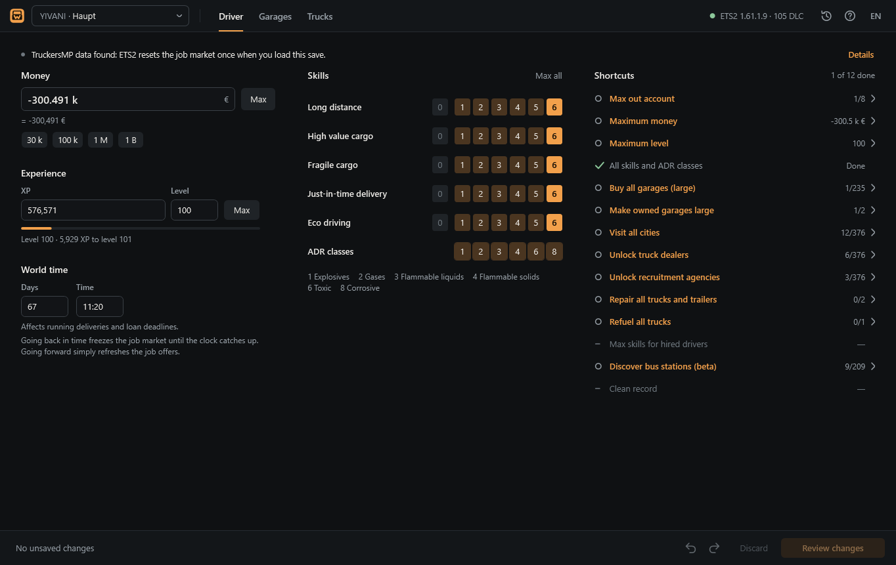
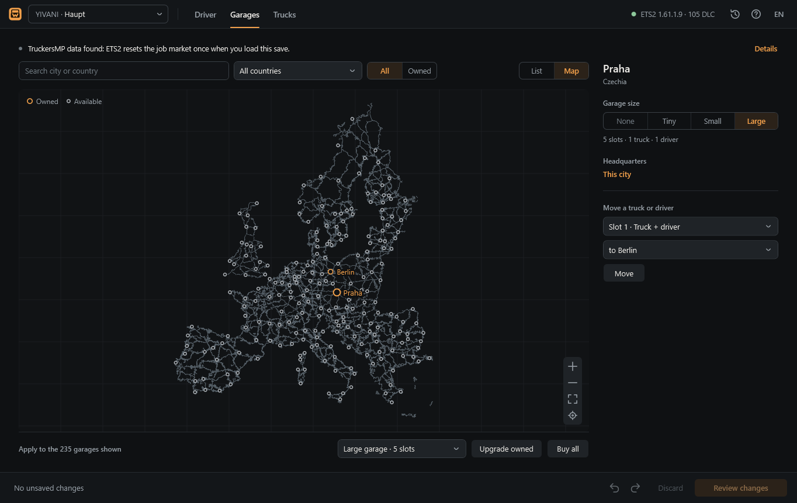
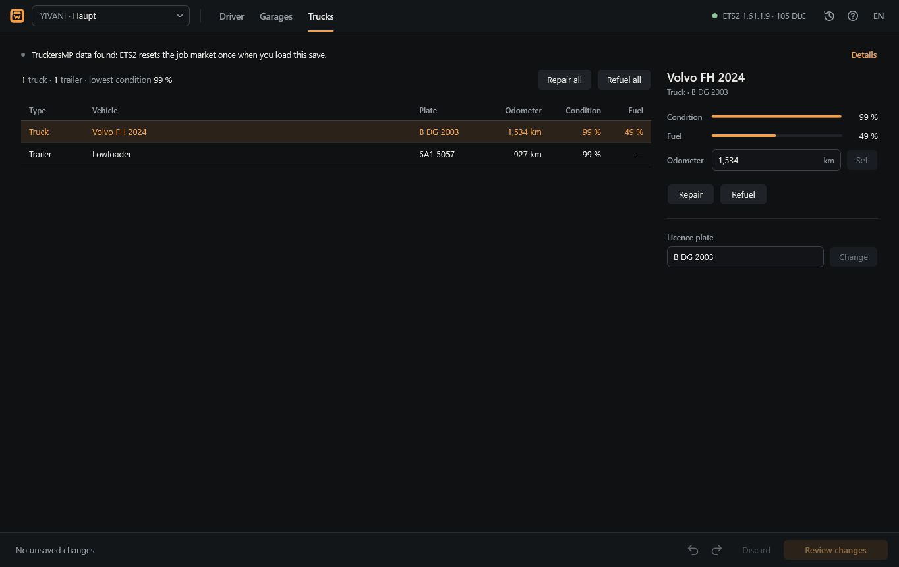

<h1 align="center">ETS2 Werkstatt</h1>

A save editor for Euro Truck Simulator 2 that shows you every change before it touches your save.

<a href="https://github.com/Yivani/ETS2-Werkstatt/releases/latest"><b>Download for Windows</b></a>

## What it does

**Driver**
- Money, with short forms (`250k`, `3 M`), a minus for debt (`-50k`) and a one-click maximum
- Experience and level, converted into each other as you type
- In-game time as days and clock time
- The five skills and all six ADR classes

**Quick actions** — one list, with what is already done ticked off:
max out the account, buy every garage, upgrade your garages, visit every city (so its jobs show up
in the freight market), unlock all truck dealers and recruitment agencies, repair and refuel all
trucks, max skills for hired drivers, discover bus stations, clean record.

**Garages**
- Every garage in your save, searchable and filterable by country
- Buy, upgrade or sell one garage, or all garages of a country at once
- Set your headquarters, move a truck and its driver to another garage

**Trucks**
- Your own trucks and trailers with condition, fuel and odometer
- Repair and refuel one or all, change the odometer and your truck's licence plate

## Before you start

1. **Turn off Steam Cloud for your profile — in the game.** ETS2 → Profiles → select your
   profile → Edit → untick “Use Steam Cloud” → confirm, then quit ETS2. The game moves the
   profile to `Documents\Euro Truck Simulator 2\profiles`, where Werkstatt finds it.
   The switch in the Steam client (Properties → “Keep game saves in the Steam Cloud”) is not
   enough: it stops syncing but leaves the profile in Steam Cloud.
2. **Quit ETS2 before saving.** You can edit while the game runs; saving waits until it is closed.
3. Windows may show “Windows protected your PC”, because the app is not code-signed.
   Click *More info* → *Run anyway*.

The app explains both steps in a short guide on first launch (press F1 to see it again).

## How saving works

- Nothing is written while you edit. Every change collects in the bar at the bottom.
- **Review changes** lists each value before and after in plain words.
- **Back up & save** copies the original save (and your key bindings) to a backup first,
  then writes the file and reads it back to check it. Backups are one click away
  (clock icon, top right) and can be restored at any time.
- Werkstatt only changes values that already exist in the save. It never adds or removes
  entries, which is what usually breaks saves in other editors.
- Opening and saving without edits produces a byte-identical file.

Not yet confirmed in game: newly unlocked dealers and agencies in cities without one, discovered
bus stations, a lowered odometer, and a cleared offence history. Try these on a copy of a save
first (save switcher → *Save a copy…*).

## TruckersMP

Edits that only affect your own profile are allowed on TruckersMP. If your save contains
TruckersMP data, single-player ETS2 shows “Changes to the game detected” once when you load it
and cancels open deliveries without penalty. That comes from the game, not from this editor;
Werkstatt tells you when a save is affected.

## Requirements

- Windows 10 or 11, 64-bit
- Euro Truck Simulator 2 (tested with 1.61), profile stored locally (see above)
- No installation and no .NET setup: the program is a single file that includes everything it
  needs (59 MB download, 134 MB unpacked).
- Works offline. No account, no telemetry, no uploads.
- English, Deutsch, Polski, Русский, 简体中文

## Licence

The program is free to download and use for your own saves. The source code is not public and
may not be reused; see [LICENSE](LICENSE). Bundled third-party components keep their own
licences: [THIRD-PARTY-NOTICES.md](THIRD-PARTY-NOTICES.md).

Euro Truck Simulator 2 is a trademark of SCS Software. This is an independent fan tool and is not
affiliated with SCS Software or TruckersMP.

## Kurz auf Deutsch

Spielstand-Editor für Euro Truck Simulator 2 – Geld, Level, Fähigkeiten, Garagen, Städte,
Händler, Lkw. Jede Änderung siehst du vor dem Speichern, das Original wird automatisch gesichert.
**Wichtig:** Steam Cloud im Spiel für das Profil ausschalten (Profile → Bearbeiten → Haken bei
„Steam Cloud verwenden“ entfernen) und ETS2 zum Speichern beenden.
[Download](https://github.com/Yivani/ETS2-Werkstatt/releases/latest)
